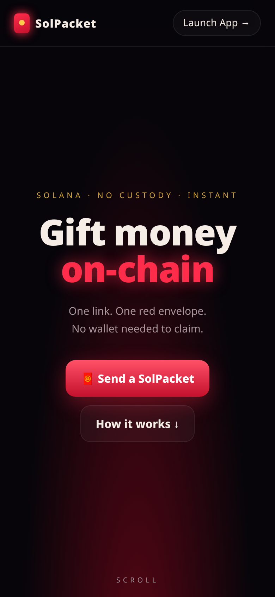
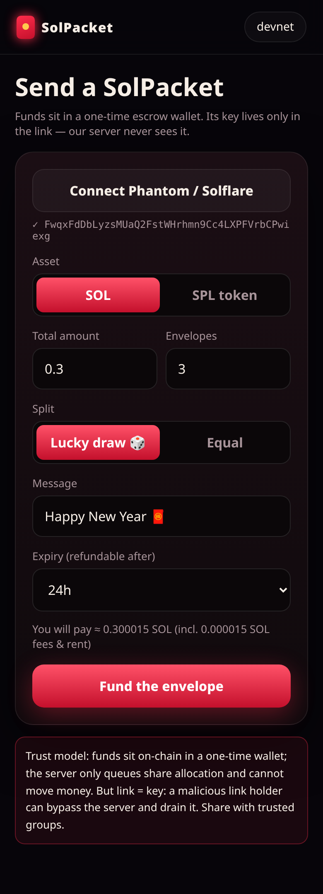
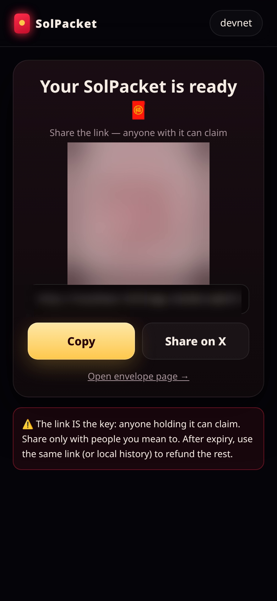
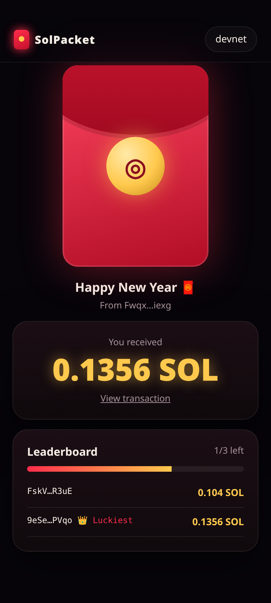

<p align="center"></p>

<h1 align="center">SolPacket 🧧</h1>
<p align="center"><b>On-chain red envelopes for Solana.</b><br>One link. One red envelope. No wallet needed to claim.</p>
<p align="center"><a href="https://solpacket.fun">solpacket.fun</a> · <a href="https://x.com/solpacket_app">@solpacket_app</a></p>

> ⚠️ **Beta / unaudited. Devnet by default.** Read the [trust model](#trust-model) before using real funds.

## Features
- **Create**: connect Phantom / Solflare, send SOL or any SPL token, set total, number of packets, *equal* or *lucky-draw* (random) split, message and expiry.
- **Share**: QR code, copy link, one-tap share to X.
- **Claim**: paste any address, use your wallet, or generate an in-browser wallet (with key backup prompt).
- **Leaderboard**: live list of claimers and amounts, luckiest-draw crown, remaining progress.
- **Refund**: after expiry, unclaimed funds sweep back to the creator.
- **Landing page**: GSAP ScrollTrigger + Lenis scroll-driven envelope opening, coin burst canvas, parallax, pinned horizontal cards; `prefers-reduced-motion` fallback.

| Create | Share | Claim |
|---|---|---|
|  |  |  |

## How it works
1. The creator's browser generates a **one-time escrow keypair** and funds it (amount + tiny fee/rent buffer) from the creator's wallet.
2. The browser registers the envelope (escrow pubkey, precomputed shares, expiry) with the server. The server verifies the escrow balance on-chain.
3. The share link is `/app.html#c=<id>&k=<escrow secret>`. The part after `#` is never sent to the server.
4. A claimer reserves a share (`/reserve`), their browser signs a transfer from the escrow with the key from the link, and the server **validates the transaction** (exact recipient, exact amount, allowed programs only) before relaying it.
5. After expiry the escrow can be swept back to the creator (`/refund`).

```
public/      static site (landing + app)      src/core.js   tx building (shared by browser & tests)
src/app.js   create/claim UI                  src/landing.js scroll animations
server.js    coordinator API (no keys)        scripts/      e2e + screenshot scripts
```

## Trust model
- ✅ **No custody**: funds sit in an on-chain escrow; the server never sees its key and cannot move funds.
- ✅ The server enforces one claim per address, share amounts, and expiry for honest clients.
- ⚠️ **Link = key.** Anyone holding the link can bypass the server and drain the escrow. Share only with groups you trust.
- ⚠️ Refund safety relies on the same key — a link holder could also sweep before expiry.

The fix is an on-chain program (see roadmap) where claims require a server-signed one-time voucher and refunds can only go to the creator.

## Quickstart (local validator)
```bash
npm install
solana-test-validator                       # in another terminal
TEST=1 HB_RPC=http://127.0.0.1:8899 npm run dev   # http://localhost:5173
npm run e2e                                 # SOL + SPL random split, 3 claims, refund
npm run shots                               # headless screenshots -> shots/ (needs Chrome)
```
Devnet: `cp .env.example .env`, set `CLUSTER=devnet`, then `npm run dev` (fund your wallet from a devnet faucet).

## Environment variables
| Var | Default | Notes |
|---|---|---|
| `CLUSTER` | `devnet` | `devnet` or `mainnet` |
| `HB_RPC` | public cluster RPC | server-side RPC |
| `HB_PUBLIC_RPC` | `HB_RPC` | RPC given to browsers — never put a private key-bearing URL here |
| `PORT` | `5173` | |
| `DB` | `./data.json` | JSON store |
| `TEST` | – | `1` enables the test-only expire endpoint |

## Roadmap
- [ ] Anchor program escrow (PDA vault, server-signed ed25519 claim vouchers, creator-only refund)
- [ ] Independent security audit before mainnet
- [ ] Wallet-adapter / wallet-standard support for more wallets, mobile deep links
- [ ] Postgres storage, rate limiting, abuse protection
- [ ] Token metadata (symbol/logo), "my packets" dashboard
- [ ] Claim directly to exchange deposit address / email login

## Links
- Website: https://solpacket.fun
- X: https://x.com/solpacket_app
- Repo: https://github.com/solpacket/solpacket

## License
[MIT](LICENSE)
